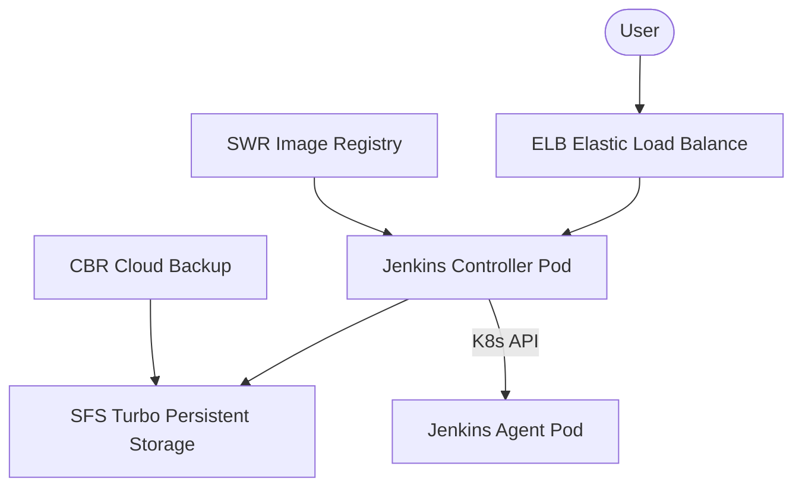

# distributed-x-infrastructure-serverless-jenkins


## 1. Overview

A best practice for running a Jenkins CI/CD controller on Huawei Cloud CCE (Cloud Container Engine). Terraform deploys a complete Jenkins platform in one step, including a managed Kubernetes cluster, persistent file storage, load balancing, a container image registry, and automated backup, so the Jenkins controller and build agents run as containers with automatic scaling.

It is designed for DevOps teams that need to quickly set up a Jenkins CI/CD platform in the cloud and reduce the infrastructure management burden.

---

## 2. Table of Contents

- [1. Overview](#1-overview)
- [2. Table of Contents](#2-table-of-contents)
- [3. Architecture Diagram](#3-architecture-diagram)
- [4. Highlights](#4-highlights)
- [5. Cloud Services Used](#5-cloud-services-used)
- [6. Prerequisites](#6-prerequisites)
- [7. Quick Start](#7-quick-start)
- [8. Step-by-Step Deployment](#8-step-by-step-deployment)
- [9. Usage / Verification](#9-usage--verification)
- [10. Cleanup](#10-cleanup)
- [11. Detailed Explanation](#11-detailed-explanation)
- [12. Dependencies](#12-dependencies)
- [13. FAQ / Troubleshooting](#13-faq--troubleshooting)
- [14. Contributing](#14-contributing)
- [15. License](#15-license)
- [16. Contact / Maintainers](#16-contact--maintainers)

---

## 3. Architecture Diagram



The full architecture diagram is in [docs/architecture.md](docs/architecture.md).

---

## 4. Highlights

- **Managed container runtime**: the Jenkins controller runs on a CCE managed Kubernetes cluster, with a control plane that requires no maintenance
- **Auto-scaling agents**: Jenkins build agents are created dynamically as Pods, and the agent node pool scales automatically with the load
- **Persistent storage**: SFS Turbo provides NFS shared storage, so JENKINS_HOME data is persisted and shareable across nodes
- **Automated backup**: CBR periodically backs up the SFS file system according to the policy, protecting Jenkins state data
- **Declarative configuration**: Jenkins is configured declaratively through JCasC (Configuration-as-Code); the image is the configuration
- **One-click deployment**: Terraform manages all cloud resources uniformly, and `terraform apply` completes the deployment in one step

---

## 5. Cloud Services Used

| Service | Purpose |
|---|---|
| CCE (Cloud Container Engine) | Managed Kubernetes cluster running the Jenkins controller and agents |
| SFS Turbo (Scalable File Service) | Persistent storage for JENKINS_HOME |
| ELB (Elastic Load Balance) | Public entry point for the Jenkins Web UI |
| SWR (Software Repository for Container) | Jenkins controller image storage |
| CBR (Cloud Backup and Recovery) | Automated backup of the SFS file system |
| KMS (Key Management Service) | Storage encryption keys |
| VPC (Virtual Private Cloud) | Network isolation and security groups |
| DNS (Domain Name Service) | Custom domain resolution (optional) |
| AOM + LTS | Container monitoring and log collection |

Cleanup: run `terraform destroy` to release all resources.

---

## 6. Prerequisites

1. **Huawei Cloud account**: CCE, SFS, ELB, SWR, CBR, and KMS services enabled
2. **AK/SK**: obtain the Access Key and Secret Key on the Huawei Cloud "My Credentials" page
3. **Terraform**: version >= 1.5
4. **kubectl**: installed and configured with Huawei Cloud CCE authentication (`kubectl` must support the CCE auth plugin)
5. **Docker**: installed for building the Jenkins controller image
6. **SSH key pair**: pre-created in the Huawei Cloud console for CCE node login
7. **Region**: defaults to cn-north-4 (Beijing 4), configurable as needed

---

## 7. Quick Start

```bash
# 1. Set credentials
export HW_ACCESS_KEY="your-access-key"
export HW_SECRET_KEY="your-secret-key"

# 2. Enter the infrastructure directory
cd infra

# 3. Initialize and deploy
terraform init
terraform plan
terraform apply
```

---

## 8. Step-by-Step Deployment

### Step 1: Build and push the Jenkins image

```bash
# Build the image and push it to SWR
cd scripts
chmod +x build.sh
./build.sh cn-north-4 jenkins-org lts-jdk17
```

Expected output:
```
=== Build Jenkins Controller Image ===
[+] Building 45.2s
 => => writing image sha256:abc123...
=== Login to SWR ===
Login Succeeded
=== Tag and push ===
Pushed: swr.cn-north-4.myhuaweicloud.com/jenkins-org/jenkins-controller:lts-jdk17
=== Done ===
```

### Step 2: Deploy the infrastructure

```bash
cd infra

# Initialize Terraform
terraform init

# Review the deployment plan
terraform plan -var="jenkins_admin_password=YourSecurePassword"

# Apply the deployment
terraform apply -var="jenkins_admin_password=YourSecurePassword"
```

Expected output:
```
Apply complete! Resources: 25 added, 0 changed, 0 destroyed.

Outputs:
cce_cluster_id = "xxxxxxxx-xxxx-xxxx-xxxx-xxxxxxxxxxxx"
jenkins_url = "http://xxx.xxx.xxx.xxx"
sfs_mount_address = "xxx.xxx.xxx.xxx:/"
swr_repository = "jenkins-org/jenkins-controller"
```

### Step 3: Access Jenkins

```bash
# Get the Jenkins URL
terraform output jenkins_url

# Open it in a browser and log in with admin / YourSecurePassword
```

---

## 9. Usage / Verification

### Verify the Jenkins deployment

```bash
# Get CCE cluster credentials
kubectl --region cn-north-4 cce auth --cluster-id $(terraform output -raw cce_cluster_id)

# Check the Jenkins Pod status
kubectl get pods -n jenkins

# Expected output:
# NAME                                  READY   STATUS    RESTARTS   AGE
# jenkins-controller-xxxx-xxxx-xxxx     1/1     Running   0          2m

# Check the Jenkins Service
kubectl get svc -n jenkins

# Expected output:
# NAME            TYPE           CLUSTER-IP      EXTERNAL-IP   PORT(S)        AGE
# jenkins-agent   ClusterIP      10.96.xxx.xxx   <none>        50000/TCP      2m
# jenkins-ui      LoadBalancer   10.96.xxx.xxx   xxx.xxx.xxx   80:xxxxx/TCP   2m
```

### Create a test Pipeline

Create a Pipeline job in the Jenkins Web UI with the following test script:

```groovy
pipeline {
    agent {
        kubernetes {
            label 'kubernetes-agent'
        }
    }
    stages {
        stage('Test') {
            steps {
                container('jnlp') {
                    sh 'echo "Jenkins agent running on CCE"'
                    sh 'kubectl version --client'
                }
            }
        }
    }
}
```

After deployment, follow the steps above to verify that the Jenkins controller Pod is running, the Web UI is accessible, and agents can be created dynamically before considering the deployment complete.

After deployment, follow these steps to verify that the business functionality works before considering the delivery complete.

---

## 10. Cleanup

```bash
cd infra
terraform destroy -var="jenkins_admin_password=YourSecurePassword"
```

After execution, all cloud resources will be released with no residue left.

---

## 11. Detailed Explanation

### Configuration items

| Variable | Description | Default |
|---|---|---|
| `region` | Huawei Cloud region | cn-north-4 |
| `name_prefix` | Resource naming prefix | sjenkins |
| `vpc_id` | Existing VPC ID (empty = create automatically) | "" |
| `cce_cluster_flavor` | CCE cluster flavor | cce.s1.small |
| `cce_controller_node_flavor` | Controller node flavor | s6.large.2 |
| `cce_agent_min_count` | Minimum agent node count | 0 |
| `cce_agent_max_count` | Maximum agent node count | 5 |
| `sfs_size_gb` | SFS capacity (GB) | 500 |
| `jenkins_admin_password` | Jenkins administrator password | ChangeMe123! |
| `cbr_backup_retention_days` | Backup retention days | 30 |

The full variable list is in [infra/variables.tf](infra/variables.tf).

### Jenkins agent scheduling

The Jenkins controller submits Pod creation requests to the CCE cluster through the Kubernetes plugin. When a build is triggered:

1. The Jenkins controller calls the K8s API to create an agent Pod
2. The agent Pod is scheduled to the agent node pool
3. If the node pool has insufficient resources, the auto-scaler provisions new nodes
4. After the build finishes, the agent Pod is destroyed
5. Idle nodes are scaled down automatically after a timeout

---

## 12. Dependencies

| Dependency | Version requirement |
|---|---|
| Terraform | >= 1.5 |
| huaweicloud Provider | ~> 1.70 |
| kubernetes Provider | ~> 2.20 |
| kubectl | CCE auth plugin support |
| Docker | any version |

---

## 13. FAQ / Troubleshooting

**Q: How to use an existing VPC?**

Set the `vpc_id` and `subnet_id` variables to point to the existing resources:
```bash
terraform apply -var="vpc_id=your-vpc-id" -var="subnet_id=your-subnet-id"
```

**Q: How to configure a custom domain?**

Set the `dns_zone_id` and `dns_domain_name` variables:
```bash
terraform apply -var="dns_zone_id=your-zone-id" -var="dns_domain_name=jenkins.yourdomain.com"
```

**Q: Jenkins agent cannot connect to the controller?**

Check whether DNS resolution inside the CCE cluster works:
```bash
kubectl exec -it <agent-pod> -n jenkins -- nslookup jenkins-agent.jenkins.svc.cluster.local
```

---

## 14. Contributing

Issues and Pull Requests are welcome. Before submitting, please ensure:

1. The code passes `terraform validate` and `terraform fmt -check`
2. New resources are declared in the "Cloud Services Used" table of the README
3. Variable changes are reflected in the "Configuration items" table of the README

---

## 15. License

This project is licensed under the MIT No Attribution license.

---

## 16. Contact / Maintainers
| Item | Content |
|---|---|
| **Creator** | [dgc-git](https://github.com/dgc-git) |
| **Maintainer** | [dgc-git](https://github.com/dgc-git) |
| **Contact** | GitHub Issues / PR (see [Section 14](#14-contributing)) |
