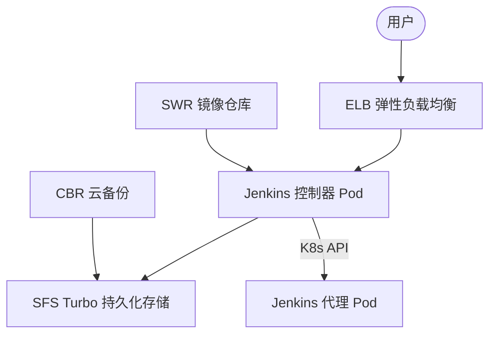

# distributed-x-infrastructure-serverless-jenkins


## 1. 简介 / Overview

### 简介


在华为云 CCE（云容器引擎）上运行 Jenkins CI/CD 控制器的最佳实践。通过 Terraform 一键部署完整的 Jenkins 平台，包含托管 Kubernetes 集群、持久化文件存储、负载均衡、容器镜像仓库和自动备份，实现 Jenkins 控制器与构建代理的容器化运行和自动伸缩。

适用于需要在云上快速搭建 Jenkins CI/CD 平台、希望减少基础设施运维负担的 DevOps 团队。

---

## 2. 目录

- [1. 简介 / Overview](#1-简介--overview)
- [2. 目录](#2-目录)
- [3. 架构图](#3-架构图)
- [4. 方案亮点](#4-方案亮点)
- [5. 涉及云服务](#5-涉及云服务)
- [6. 前置条件](#6-前置条件)
- [7. 快速开始](#7-快速开始)
- [8. 分步部署](#8-分步部署)
- [9. 使用方法 / 验证](#9-使用方法--验证)
- [10. 清理资源](#10-清理资源)
- [11. 详细说明](#11-详细说明)
- [12. 依赖](#12-依赖)
- [13. FAQ / 故障排除](#13-faq--故障排除)
- [14. 贡献指南](#14-贡献指南)
- [15. 许可证](#15-许可证)
- [16. 联系方式 / 维护者](#16-联系方式--维护者)

---

## 3. 架构图



完整架构图见 [docs/architecture.md](docs/architecture.md)。

---

## 4. 方案亮点

- **托管容器运行**：Jenkins 控制器运行在 CCE 托管 Kubernetes 集群上，控制面免运维
- **自动伸缩代理**：Jenkins 构建代理以 Pod 形式动态创建，代理节点池根据负载自动伸缩
- **持久化存储**：SFS Turbo 提供 NFS 共享存储，JENKINS_HOME 数据持久化且多节点可共享
- **自动备份**：CBR 按策略定期备份 SFS 文件系统，保障 Jenkins 状态数据安全
- **声明式配置**：通过 JCasC（Configuration-as-Code）实现 Jenkins 声明式配置，镜像即配置
- **一键部署**：Terraform 统一管理所有云资源，`terraform apply` 一键完成部署

---

## 5. 涉及云服务

| 服务 | 用途 |
|------|------|
| CCE（云容器引擎） | 托管 Kubernetes 集群，运行 Jenkins 控制器和代理 |
| SFS Turbo（弹性文件服务） | JENKINS_HOME 持久化存储 |
| ELB（弹性负载均衡） | Jenkins Web UI 公网入口 |
| SWR（容器镜像仓库） | Jenkins 控制器镜像存储 |
| CBR（云备份） | SFS 文件系统自动备份 |
| KMS（密钥管理服务） | 存储加密密钥 |
| VPC（虚拟私有云） | 网络隔离与安全组 |
| DNS（云解析服务） | 自定义域名解析（可选） |
| AOM + LTS | 容器监控与日志采集 |

清理资源：执行 `terraform destroy` 即可释放所有资源。

---

## 6. 前置条件

1. **华为云账号**：已开通 CCE、SFS、ELB、SWR、CBR、KMS 服务
2. **AK/SK**：在华为云「我的凭证」页面获取 Access Key 和 Secret Key
3. **Terraform**：>= 1.5 版本
4. **kubectl**：已安装并配置好华为云 CCE 认证（`kubectl` 需支持 CCE auth 插件）
5. **Docker**：已安装 Docker，用于构建 Jenkins 控制器镜像
6. **SSH 密钥对**：在华为云控制台预先创建 SSH 密钥对，用于 CCE 节点登录
7. **区域**：默认使用 cn-north-4（北京四），可根据需要修改

---

## 7. 快速开始

```bash
# 1. 设置凭证
export HW_ACCESS_KEY="your-access-key"
export HW_SECRET_KEY="your-secret-key"

# 2. 进入基础设施目录
cd infra

# 3. 初始化并部署
terraform init
terraform plan
terraform apply
```

---

## 8. 分步部署

### 步骤 1：构建并推送 Jenkins 镜像

```bash
# 构建镜像并推送到 SWR
cd scripts
chmod +x build.sh
./build.sh cn-north-4 jenkins-org lts-jdk17
```

预期输出：
```
=== 构建 Jenkins 控制器镜像 ===
[+] Building 45.2s
 => => writing image sha256:abc123...
=== 登录 SWR ===
Login Succeeded
=== 打标签并推送 ===
Pushed: swr.cn-north-4.myhuaweicloud.com/jenkins-org/jenkins-controller:lts-jdk17
=== 完成 ===
```

### 步骤 2：部署基础设施

```bash
cd infra

# 初始化 Terraform
terraform init

# 查看部署计划
terraform plan -var="jenkins_admin_password=YourSecurePassword"

# 执行部署
terraform apply -var="jenkins_admin_password=YourSecurePassword"
```

预期输出：
```
Apply complete! Resources: 25 added, 0 changed, 0 destroyed.

Outputs:
cce_cluster_id = "xxxxxxxx-xxxx-xxxx-xxxx-xxxxxxxxxxxx"
jenkins_url = "http://xxx.xxx.xxx.xxx"
sfs_mount_address = "xxx.xxx.xxx.xxx:/"
swr_repository = "jenkins-org/jenkins-controller"
```

### 步骤 3：访问 Jenkins

```bash
# 获取 Jenkins URL
terraform output jenkins_url

# 在浏览器中打开，使用 admin / YourSecurePassword 登录
```

---

## 9. 使用方法 / 验证

### 使用方法


### 验证 Jenkins 部署

```bash
# 获取 CCE 集群认证
kubectl --region cn-north-4 cce auth --cluster-id $(terraform output -raw cce_cluster_id)

# 检查 Jenkins Pod 状态
kubectl get pods -n jenkins

# 预期输出：
# NAME                                  READY   STATUS    RESTARTS   AGE
# jenkins-controller-xxxx-xxxx-xxxx     1/1     Running   0          2m

# 检查 Jenkins Service
kubectl get svc -n jenkins

# 预期输出：
# NAME            TYPE           CLUSTER-IP      EXTERNAL-IP   PORT(S)        AGE
# jenkins-agent   ClusterIP      10.96.xxx.xxx   <none>        50000/TCP      2m
# jenkins-ui      LoadBalancer   10.96.xxx.xxx   xxx.xxx.xxx   80:xxxxx/TCP   2m
```

### 创建测试 Pipeline

在 Jenkins Web UI 中创建 Pipeline 任务，使用以下测试脚本：

```groovy
pipeline {
    agent {
        kubernetes {
            label 'kubernetes-agent'
        }
    }
    stages {
        stage('Test') {
            steps {
                container('jnlp') {
                    sh 'echo "Jenkins agent running on CCE"'
                    sh 'kubectl version --client'
                }
            }
        }
    }
}
```

部署完成后请按上述步骤自行验证，确认 Jenkins 控制器 Pod 正常运行、Web UI 可访问、代理可动态创建，方可视为部署完成。

部署完成后请按本节步骤自行验证，确认业务功能可用，方可视为交付完成。

---

## 10. 清理资源

```bash
cd infra
terraform destroy -var="jenkins_admin_password=YourSecurePassword"
```

执行后所有云资源将被释放，避免残留。

---

## 11. 详细说明

### 配置项

| 变量 | 说明 | 默认值 |
|------|------|--------|
| `region` | 华为云区域 | cn-north-4 |
| `name_prefix` | 资源命名前缀 | sjenkins |
| `vpc_id` | 已有 VPC ID（留空自动创建） | "" |
| `cce_cluster_flavor` | CCE 集群规格 | cce.s1.small |
| `cce_controller_node_flavor` | 控制器节点规格 | s6.large.2 |
| `cce_agent_min_count` | 代理节点最小数 | 0 |
| `cce_agent_max_count` | 代理节点最大数 | 5 |
| `sfs_size_gb` | SFS 容量（GB） | 500 |
| `jenkins_admin_password` | Jenkins 管理员密码 | ChangeMe123! |
| `cbr_backup_retention_days` | 备份保留天数 | 30 |

完整变量列表见 [infra/variables.tf](infra/variables.tf)。

### Jenkins 代理调度

Jenkins 控制器通过 Kubernetes 插件向 CCE 集群提交 Pod 创建请求。当构建任务触发时：

1. Jenkins 控制器调用 K8s API 创建代理 Pod
2. 代理 Pod 被调度到代理节点池
3. 若节点池资源不足，自动伸缩器扩容新节点
4. 构建完成后，代理 Pod 被销毁
5. 空闲节点在超时后自动缩容

---

## 12. 依赖

| 依赖 | 版本要求 |
|------|---------|
| Terraform | >= 1.5 |
| huaweicloud Provider | ~> 1.70 |
| kubernetes Provider | ~> 2.20 |
| kubectl | 支持 CCE auth 插件 |
| Docker | 任意版本 |

---

## 13. FAQ / 故障排除

### FAQ


**Q: 如何使用已有 VPC？**

设置 `vpc_id` 和 `subnet_id` 变量指向已有资源：
```bash
terraform apply -var="vpc_id=your-vpc-id" -var="subnet_id=your-subnet-id"
```

**Q: 如何配置自定义域名？**

设置 `dns_zone_id` 和 `dns_domain_name` 变量：
```bash
terraform apply -var="dns_zone_id=your-zone-id" -var="dns_domain_name=jenkins.yourdomain.com"
```

**Q: Jenkins 代理无法连接控制器？**

检查 CCE 集群内部 DNS 解析是否正常：
```bash
kubectl exec -it <agent-pod> -n jenkins -- nslookup jenkins-agent.jenkins.svc.cluster.local
```

---

## 14. 贡献指南

欢迎提交 Issue 和 Pull Request。提交前请确保：

1. 代码通过 `terraform validate` 和 `terraform fmt -check`
2. 新增资源需在 README 的「涉及云服务」表格中声明
3. 变量变更需同步更新 README 的「配置项」表格

---

## 15. 许可证

本项目采用 MIT No Attribution 许可证。

---

## 16. 联系方式 / 维护者
| 项 | 内容 |
|---|---|
| **创建者** | [dgc-git](https://github.com/dgc-git) |
| **维护者** | [dgc-git](https://github.com/dgc-git) |
| **联系方式** | GitHub Issues / PR（见[第 14 节](#14-贡献指南)） |
