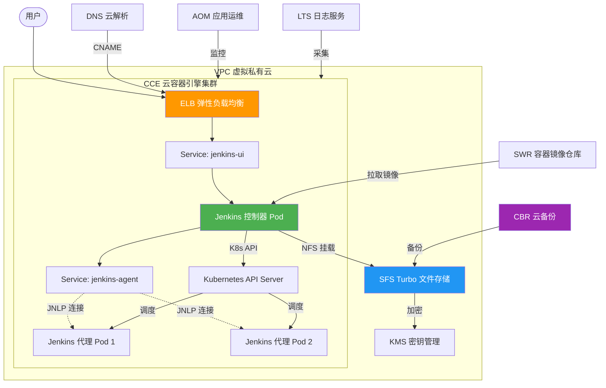

# 架构说明

## 架构图

## 架构组件

| 组件 | 华为云服务 | 作用 |
|------|-----------|------|
| 负载均衡 | ELB（弹性负载均衡） | Jenkins Web UI 公网入口，健康检查 |
| 容器集群 | CCE（云容器引擎） | 托管 Kubernetes 集群，运行 Jenkins 控制器和代理 |
| 控制器节点池 | CCE 节点池 | 固定节点运行 Jenkins 控制器 |
| 代理节点池 | CCE 节点池（自动伸缩） | 动态创建/销毁节点运行 Jenkins 构建代理 |
| 持久化存储 | SFS Turbo（弹性文件服务） | JENKINS_HOME 有状态存储，NFS 协议挂载 |
| 容器镜像 | SWR（容器镜像仓库） | 存储 Jenkins 控制器自定义镜像 |
| 备份 | CBR（云备份） | SFS 文件系统自动备份 |
| 加密 | KMS（密钥管理服务） | 存储加密密钥 |
| 监控 | AOM + LTS | 容器监控与日志采集 |
| DNS | DNS（云解析服务） | 自定义域名解析（可选） |

## 工作流程

1. **用户访问**：用户通过 DNS 域名或 EIP 访问 Jenkins Web UI，流量经 ELB 转发到 CCE 中的 Jenkins 控制器 Pod
2. **持久化**：Jenkins 控制器通过 NFS 协议挂载 SFS Turbo 文件系统，JENKINS_HOME 数据持久化存储
3. **代理调度**：当构建任务触发时，Jenkins 控制器通过 Kubernetes 插件向 CCE 集群提交 Pod 创建请求，代理 Pod 在代理节点池中动态创建
4. **自动伸缩**：代理节点池根据 Pod 调度需求自动扩容节点，空闲时自动缩容
5. **备份**：CBR 按策略定期备份 SFS 文件系统，保护 Jenkins 状态数据
6. **监控**：AOM 采集容器指标，LTS 采集容器日志
